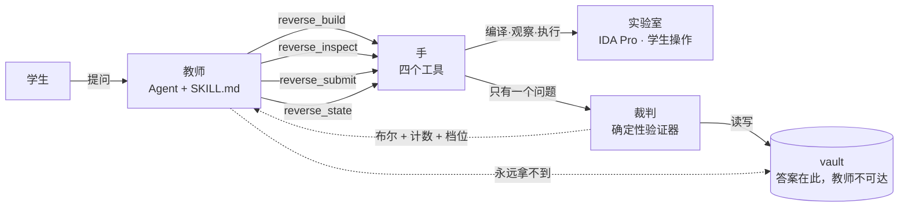

# 发布会：一个学会"不告诉你答案"的 Agent

> 关于 `reverse-tutor` —— DeepSeek Harness 的逆向工程教练插件，从 Agent 架构讲起。

---

## 开场：三个你我都见过的失败

**第一个失败。** 你问 AI："教我逆向工程。"

它给了你一篇三千字的教程。结构清晰、术语准确、引用规范。你读完了，然后呢？你还是不会看一个 stripped 二进制。**因为它讲的是"关于逆向的知识"，不是"让你获得逆向的能力"。**

**第二个失败。** 你让它出题。它出了一道题，还贴心地附上了解法——在同一个回答里。你说"别告诉我答案"，它道歉，然后下一句话就把答案漏了。

**第三个失败，也是最要命的。** 你答了。它说："完全正确！你的分析非常到位！"

**凭什么？** 谁说的？它凭什么知道你对了？它凭什么知道你"分析到位"？

它不知道。它在夸你。而一个会夸人的系统，是最不适合当老师的系统。

---

## 洞察：Agent 的四个器官

大多数"AI 教学"产品把一切都塞进一个提示词里：让它讲、让它出题、让它判分、让它鼓励你。

我们把 Agent 拆开，按**能力边界**而不是按功能模块拆：

| 器官 | 谁来做 | 一句话职责 |
|---|---|---|
| **教师** | Agent + 教学策略 | 决定问什么、何时提示、怎么讲解 |
| **实验室** | IDA Pro，学生亲手操作 | 反汇编、伪代码、交叉引用——**学生自己的眼睛** |
| **手** | 插件的四个工具 | 构建、观察、执行——**只做事实操作** |
| **裁判** | 确定性验证器 | 回答一个问题：这是不是正确答案 |

然后我们做了一个违反直觉的决定：

> **让教师永远看不到答案。**

不是"提示词里叮嘱它别看"，不是"让它自觉"。是**架构上拿不到**：答案存在会话工作区之外，插件的四个工具没有任何一个返回它的路径。

**我们不把希望寄托在提示词上。** 这是整个设计的起点。

---

## 架构揭幕



数据流只有一句话：**Agent 只做决策，工具只做执行，文件系统是唯一的事实来源，答案只进不出。**

四个工具，就是 Agent 在这个世界里的四只手：

| 工具 | 教师用它来做什么 | 它刻意做不到什么 |
|---|---|---|
| `reverse_build` | 生成一道真实的 32 位 ELF crackme 并登记验证记录 | 返回答案——只回路径、长度、任务书 |
| `reverse_inspect` | 有界地看事实：格式、字符串、节头、单个函数的反汇编 | 替学生分析；看整个节；超出 12000 字 |
| `reverse_submit` | 拿到最终裁决 | 返回答案、参考数据、密钥 |
| `reverse_state` | 读写学习状态：阶段、尝试数、提示等级、五项技能分 | 替教师做教学判断 |

---

## 现场演示：一句话，十步

学生在对话里说：**"学习 XOR。"**

**第一步 · 定主题。** 教师一句话复述主题。不问你"基础怎么样"——那是在推卸教学责任。

**第二步 · 讲基础。** 一屏以内的 3–5 个二进制层面的事实，每条都是"你待会儿会在 IDA 里看到的形态"：一种指令形状、一个数据结构、一种调用模式。**不讲泛泛的语言语义，不剧透即将生成的题目。**

**第三步 · 小测验。** 3–4 道选择题，只考刚讲过的事实。答完逐题批改。**全对，才有资格上 intermediate；错两题，回 beginner。** 测验没批改完，不出题。

**第四步 · 出题。** 教师调用 `reverse_build`：选模板 → 生成秘密 → **只把编码后的参考字节注入 C 源码** → 编译 → 自测 → 答案锁进 vault。

学生拿到什么？二进制路径、答案长度、任务书。
教师拿到什么？**一样。** 它从头到尾也没见过答案。

**第五步 · 分析。** 教师一次只问一个问题，然后停下等。开场问题通常是：**"你认为哪个函数决定对错？为什么？"** 学生把光标放进那个函数，运行导出脚本，说"导出了"。

**第六步 · 证据追问。** 教师读到你屏幕上的函数（`ida_context`），之后每个问题都对着它问。每个结论必须给出证据：地址、指令、交叉引用、字符串、寄存器值。**"看着像校验函数"不被接受——即使猜对了。**

**第七步 · 评分与裁决。** 教师按 0–2 量规评你的**推理过程**（关键函数、参数流、控制流、数据流、证据质量），最终答案交给裁判。

**第八步 · 提示，一次一条。** 答错一次，等级才 +1：`0` 观察 → `1` 定位 → `2` 指到指令 → `3` 追一个值 → `4` 讲一层局部语义。教师只能按当前等级给一条，不能叠加，不能自己升降级。**等级 4 还答错，说明题选错了——换一道更简单的，并说明为什么。**

**第九步 · 完整讲解。** 只在验证通过之后。入口 → 输入缓冲 → 循环 → 变换 → 参考数据 → 比较 → 为什么只有这个值成立。**答对了也不跳过。**

**第十步 · 下一题。** 记录弱项，基于弱项推荐下一题，用一句话说明理由。

---

## 为什么它骗不了你：三条不可协商的线

### 一、答案不在交付物里

学生能拿到的 `challenge.c` 和二进制里，只有**密文**：

| 模板 | 存进源码和二进制的是什么 |
|---|---|
| `xor-loop` | `value[i] ^ key[i % width]` |
| `strcmp` | `value[i] ^ keystream[i]`，keystream 来自二进制随身携带的 64 位 LCG |
| `arithmetic` | `(value[i] + i) * scale - (bias + step * i)` |
| `branch` | 每个字符的分段变换 |
| `function-args` | 三段切片摘要，值被拆到三个永远看不到完整串的函数里 |

`strings` 和 `.rodata` dump 给学生的是密文。**把它反推出来，就是练习本身。**

而这一点不是靠自觉——`test/build.test.mjs` 对每个模板断言：答案不得以字节序列出现在源码或二进制中。

### 二、裁判不是模型

三档验证，结果会诚实标出它出自哪一档：

| 档位 | 条件 | 方式 |
|---|---|---|
| `executed` | 宿主原生跑 Linux ELF | 真实执行，读退出码——**金标准** |
| `executed-foreign` | 有 WSL 或 qemu-user | 经运行时执行同一二进制 |
| `predicate` | 都没有 | 模板谓词判定 |

两档一致性由 `test/submit.test.mjs` 断言。**一个说不清自己怎么知道的导师，不配给你打分。**

### 三、Agent 拿不到答案

vault 在工作区之外，四个工具没有一个返回它的路径。裁决结果只有：一个布尔值、尝试计数、一个粗略原因码。想套话？教师自己也不知道。

---

## 安全：如果 Agent 被提示注入

我们假设 Agent 会被诱导。所以限制写在代码里，不写在提示词里：

- **路径收容** —— 每个路径都过 `resolveInside()`：拒绝绝对路径、`..`、NUL、同前缀兄弟目录欺骗
- **不开 shell** —— 子进程 `shell: false` + 结构化参数，调用方字符串永远到不了命令行
- **有界执行** —— 编译 20s / 观察 8s / 验证 5s，卡住的构建不能拖死一个回合
- **有界输出** —— 一切结果截断到 12000 字并显式告知；`objdump` 只解析一个函数，绝不给整个节
- **最小权限的靶子** —— 挑战是 freestanding 的：除 stdin/stdout 的 `read`/`write` 外不碰内核，更不碰网络
- **零运行时依赖** —— 只用 Node 内建模块，宿主 API 用 `dsh-shim.ts` 本地声明，profile 安装永远不会因缺传递依赖而失败

---

## 数字

| 指标 | 值 |
|---|---|
| 模型可见的工具 | **4 个** |
| 教学策略 | **1 份**（`SKILL.md`：闭环、十戒、提示阶梯、量规） |
| 挑战模板 | **10 个**（5 主题 × 2 难度），每个都是真实可运行的 ELF32 i386 |
| 提示阶梯 | **6 级**，只能由裁判推进 |
| 技能维度 | **5 项** + 弱点记录驱动下一题 |
| 验证档位 | **3 档**，一致性有测试断言 |
| 测试 | **62 个**，含"答案不得出现在二进制里"这类硬断言 |
| 运行时依赖 | **0** |

---

## One more thing

这套架构不是逆向工程专用的。

任何一个"教人一门手艺"的 Agent，都面对同一个问题：**它知道的太多了，而它一开口，学习就结束了。**

`reverse-tutor` 给出的答案是三条可复用的架构原则：

1. **把标准答案放到 Agent 够不到的地方**——不是靠提示词纪律，是靠可达性边界；
2. **把"判"从"教"里拆出来，交给不经过模型的确定性代码**——模型评过程，代码裁结果；
3. **把观察有界化**——只给它一个函数、12000 字、8 秒，让它问出对着学生屏幕的问题，而不是对着自己的记忆。

教师、实验室、手、裁判。四个器官，各归其位。

---

## 装上它

```sh
git clone https://github.com/Jack-infinity420/reverse-tutor.git
cd reverse-tutor && npm install && npm run build
dsh plugin --profile <你的-profile> add "file:$PWD"
```

重启 profile，然后说一句：

```
学习 XOR
```

**它会教你，但它不会告诉你答案。**
这一次，它真的不知道。
